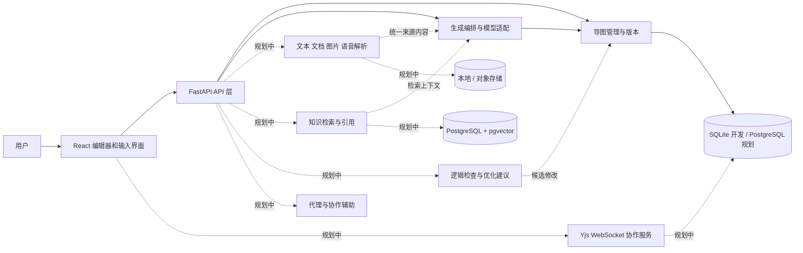

# 系统架构设计

## 目标与当前边界

申报书涉及文本、图片、语音、PPT/文档、多模态融合、布局与风格、知识库、知识图谱、逻辑优化、协作、AI 代理和评估。这些都保留在架构与 [功能清单](FEATURES_AND_OWNERS.md) 中。当前代码仅是可启动骨架；列表中的“待实现”不代表已经可用。

图中虚线部分均为待实现设计；图上的连接表示目标职责，不代表现阶段已经接通。当前生成结果由客户端显式保存，生成服务不直接持久化。

## 模块边界

| 模块 | 当前代码 / 计划位置 | 输入 → 输出 | 职责 |
|---|---|---|---|
| 导图编辑 | `frontend/src/App.tsx` | 导图 JSON → 修改后的 JSON | 当前树形列表；后续拆分编辑器组件、接入 React Flow 画布和布局。 |
| 导图管理 | `backend/app/mindmaps/` | 导图 JSON + 版本 → 保存记录 | 当前 SQLite 本地存储；后续 PostgreSQL、用户权限、历史版本。 |
| 生成与模型适配 | `backend/app/generation/` | 文本 → 导图 JSON | 演示适配器和基础模型适配；后续接入生成任务、提示词管理和重试策略。 |
| 共享数据契约 | `backend/app/contracts/`，`frontend/src/types.ts` | 结构验证 | 当前约定树及限制；修改必须两端同步。 |
| 多模态输入（部分实现） | `backend/app/ingestion/` | 文本 → 来源；其他输入待实现 | JSON 文本和 Markdown 可用；文件上传、识别及来源定位待实现。 |
| 知识增强（待实现） | `backend/app/knowledge/` | 文档 → 分块/向量；问题 → 有来源片段 | 当前只有明确标识为未实现的检索桩；真实知识库与引用待开发。 |
| 逻辑优化（部分实现） | `backend/app/optimization/` | 当前导图 → 结构提示 | 单子节点、深度上限、同级重复提示可用；语义纠错等待实现。 |
| AI 代理（待实现） | `backend/app/agent/` | 目标/协作内容 → 带依据的方案或建议 | 当前只返回固定阶段桩；多步骤规划等能力待实现。 |
| 协作（待实现） | 规划独立 `collaboration/` 服务与前端绑定 | 房间操作/在线状态 → 共享状态 | 使用 Yjs 和 WebSocket 的候选方案，需鉴权、持久化、恢复和冲突测试。 |
| 评估（待实现） | 规划 `eval/` | 样本、生成结果 → 指标 | 结构、质量、多模态和延迟评估，保留可复现数据与结果。 |

部分模块目录已创建，但接口桩不等于功能完成。具体状态以 [API 契约](API.md) 为准。

## 数据与调用约定

1. 当前树以 `MindMapContent` 为唯一数据结构，节点 ID 唯一。后端限制最多 300 节点、8 层、每节点最多 50 个孩子；前端与后端需按 [API 契约](API.md) 联调。
2. 将来树以外的因果/引用连接应在版本化 schema 中新增独立 `relations`，包含来源节点、目标节点、关系类型及可追溯证据，不能通过重复节点冒充。布局、节点样式与语义结构分离，并规划迁移。
3. 当前多来源流水线将实际使用的来源 ID、类型、文件名及字符数写入 `MindMapContent.source_usage`，可随导图保存；这是整图摘要，不保存原文或节点引用。未来文档、图片和音频处理仍需来源存储、分段定位、页码/时间戳及节点级关联。
4. AI 返回的是候选内容：服务端校验后返回；逻辑优化为候选变更，必须由用户确认，避免覆盖手工编辑。模型密钥只在服务端保存。
5. 当前同步请求适合原型。后续导入、长文本、语音识别可改成持久任务：`pending → running → succeeded/failed`，支持超时、重试与状态查询；进度通过 SSE 单向通知。队列及 SSE 现在没有实现。
6. 当前保存使用乐观锁。多人实时协作需要单独的 CRDT 同步与持久化，不应将当前版本号机制当作实时合并方案。

## 技术选择及来源

- **React + TypeScript、FastAPI + Pydantic**：和申报书前端方向一致，Python 便于对接模型与解析工具。开源项目 [ultra-mindmap](https://github.com/Anionex/ultra-mindmap) 展示了 FastAPI + React + 模型生成导图的思路；其项目结构仅作参考。
- **React Flow（规划）**：用于节点与连线式交互，参见 [xyflow/xyflow](https://github.com/xyflow/xyflow)。当前仅有树状列表，画布和树布局尚未接入。
- **Docling（候选，未接入）**：支持 PDF、DOCX、PPTX 等统一处理，参见 [支持格式](https://github.com/docling-project/docling/blob/main/docs/usage/supported_formats.md)。运行成本、复杂排版及识别质量需实际测试，也可先使用轻量解析器。
- **PostgreSQL + pgvector（规划）**：PostgreSQL 保存业务数据，pgvector 实现向量检索；参见 [pgvector](https://github.com/pgvector/pgvector)。当前存储仅为 SQLite，没有 PostgreSQL 或向量检索实现。
- **Yjs + y-websocket（规划）**：Yjs 提供共享数据类型，y-websocket 是其 WebSocket 连接方案；参见 [Yjs](https://github.com/yjs/yjs)、[y-websocket](https://github.com/yjs/y-websocket)。需要额外实现用户权限、房间授权、持久化、恢复和数据格式映射。
- **PUML（部分实现）**：已提供结构化导图转 PUML 文本的接口；渲染和前端导出入口尚待实现。`plantuml-encoder` 与 `viz.js` 各自职责不同，不能假定组合就能直接渲染任意 PlantUML。

以上为技术调研和候选选型，不表示引用项目的代码已被复制，也不暗示它们已证明满足本项目的性能指标。引入第三方组件前应核对许可证和依赖。

## 安全与部署边界

当前仅限本机开发：没有用户认证、权限隔离、文件上传及生产日志策略。接入文件、知识库和协作前，应增加用户身份与资源授权、上传大小和类型限制、恶意文件防护、密钥管理、外部请求限制、日志脱敏及备份；未经授权不得上传敏感资料。未来使用 Docker Compose 编排应用和数据库，Kubernetes 为扩容选项，均未配置或验证。
