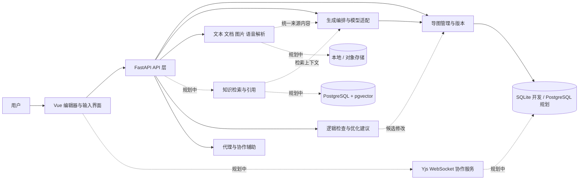

# 系统架构设计

## 目标与当前边界

申报书涉及文本、图片、语音、PPT/文档、多模态融合、布局与风格、知识库、知识图谱、逻辑优化、协作、AI 代理和评估。这些都保留在架构与 [功能清单](FEATURES_AND_OWNERS.md) 中。截至 2026-11-07，文本到导图的整条链路、多来源解析（文档 / 图片 / 语音）、节点级引用及其界面展示、三种导出与 Agent 工具循环已经落地；知识库、知识图谱、协作、多布局与主题、容器化部署仍是设计。列表中的“待实现”不代表已经可用。

图中虚线部分均为待实现设计；实线表示当前已接通。生成结果仍由客户端显式保存，生成服务不直接持久化。

## 模块边界

| 模块 | 当前代码 / 计划位置 | 输入 → 输出 | 职责 |
|---|---|---|---|
| 导图编辑 | `frontend/src/App.vue`、`frontend/src/canvas/`、`frontend/src/stores/mindmap.ts`、`frontend/src/mindmap/` | 导图 JSON → 修改后的 JSON | R2 接入 `@vue-flow/core` 画布与自研 tidy-tree 布局（平移 / 缩放 / 点选看全文 / 四种方向）；R3 接入内联改名、Tab 建子节点、Enter 建兄弟、删子树、50 步撤销重做与乐观锁保存。 |
| 导图管理 | `backend/app/mindmaps/` | 导图 JSON + 版本 → 保存记录 | 当前 SQLite 本地存储；后续 PostgreSQL、用户权限、历史版本。 |
| 生成与模型适配 | `backend/app/generation/` | 文本 → 导图 JSON | 演示适配器和基础模型适配；后续接入生成任务、提示词管理和重试策略。 |
| 共享数据契约 | `backend/app/contracts/`，`frontend/src/api/types.ts`，[CONTRACT_V2](CONTRACT_V2.md) | 结构验证 | 当前后端仍是 v1 契约（`docs/API.md`）；v2 已冻结候选、待 D2 落地，届时前端类型由 `openapi-typescript` 生成，不再手写。 |
| 多模态输入 | `backend/app/ingestion/`、`frontend/src/sources/`、`frontend/src/audio/` | 文本 / 文档 / 图片 / WAV 音频 → 来源 | 文本、Markdown、文档上传（PDF 逐页渲染交模型视觉识别；DOCX/PPTX/XLSX/HTML/MD 走 Docling；`.doc`/`.ppt` 经 LibreOffice 转换；`.xls` 走 `xlrd`）、图片理解（与 PDF 共用 `ingestion/vision_pdf.py` 的调用）与语音转写（百炼 Qwen-Audio-ASR，带句级时间戳，`ingestion/asr.py`）均可用。 |
| 来源引用 | `backend/app/optimization/source_refs.py`、`backend/app/optimization/nli.py`（展示在 `frontend/src/mindmap/refs.ts`） | 节点 + 来源 → 校验后的 `source_refs` | 节点级引用随导图保存：机械核验（引文能在来源里找到）为主，可选中文 NLI（`MINDMAP_NLI_*`）复核。**界面已接入**（2026-11-07，`fc8f82f`）：角标显示条数，详情面板列来源与位置，抽屉里看原文并高亮命中句；原文不落库，跨会话只能看 `quote`。 |
| 知识增强（待实现） | `backend/app/knowledge/` | 文档 → 分块/向量；问题 → 有来源片段 | 当前只有明确标识为未实现的检索桩；真实知识库与引用待开发。 |
| 逻辑优化（部分实现） | `backend/app/optimization/` | 当前导图 → 结构提示 | 单子节点、深度上限、同级重复提示可用；语义纠错等待实现。 |
| AI 代理（部分实现） | `backend/app/agent/` | 目标 + 来源 + 当前树 → 候选 op 批次 | 受限 tool-calling 循环已可用（`/api/agent/runs/stream`，四个工具、预算上限、SSE v2 事件、前端候选确认）；`/api/agent/tasks` 仍是固定阶段桩，任务化长跑与多角色未做。 |
| 协作（待实现） | 规划独立 `collaboration/` 服务与前端绑定 | 房间操作/在线状态 → 共享状态 | 使用 Yjs 和 WebSocket 的候选方案，需鉴权、持久化、恢复和冲突测试。 |
| 评估（待实现） | 规划 `eval/` | 样本、生成结果 → 指标 | 结构、质量、多模态和延迟评估，保留可复现数据与结果。 |

部分模块目录已创建，但接口桩不等于功能完成。具体状态以 [API 契约](API.md) 为准。

## 数据与调用约定

1. 当前树以 `MindMapContent` 为唯一数据结构，节点 ID 唯一。后端限制最多 300 节点、8 层、每节点最多 50 个孩子；前端与后端需按 [API 契约](API.md) 联调。
2. 将来树以外的因果/引用连接应在版本化 schema 中新增独立 `relations`，包含来源节点、目标节点、关系类型及可追溯证据，不能通过重复节点冒充。布局、节点样式与语义结构分离，并规划迁移。
3. 当前多来源流水线将实际使用的来源 ID、类型、文件名及字符数写入 `MindMapContent.source_usage`，节点级的 `source_refs`（来源 ID、页码、字符区间、引文）随导图保存；这两者是摘要与定位信息，**不保存原文**，所以引用只能在本次请求内回查（界面在本次会话里回查原文，重新打开后只剩 `quote`）。原文持久化、跨请求回查与页码/时间戳在界面上的展示仍待补。
4. AI 返回的是候选内容：服务端校验后返回；Agent 产物是 op 批次、挂在候选副本上，逻辑优化只给建议，都必须由用户确认，避免覆盖手工编辑。模型密钥只在服务端保存。
5. 当前生成用同步请求或 SSE 流式，适合原型。导入、长文本、语音识别仍可能跑很久：持久任务（`pending → running → succeeded/failed`，支持超时、重试、状态查询）只在 `docs/ARCHITECTURE_ADDENDUM.md` 里设计过，代码里没有队列，也没有可断线重放的任务事件接口。
6. 当前保存使用乐观锁。多人实时协作需要单独的 CRDT 同步与持久化，不应将当前版本号机制当作实时合并方案。

## 技术选择及来源

- **Vue 3 + TypeScript、FastAPI + Pydantic**：申报书原定 React 前端，实际改为 Vue 生态——负责前端的人只有 Vue 实战经验，而考核要求"必须能讲清代码逻辑"，自己写比沿用不熟的骨架更可靠；旧 React 骨架打 tag `v0.1.0-react-scaffold` 存档。开源项目 [ultra-mindmap](https://github.com/Anionex/ultra-mindmap) 展示了 FastAPI + 前端框架 + 模型生成导图的思路，仅作参考。
- **Vue Flow（已接入，R2）**：`@vue-flow/core` 负责节点与连线交互（参见 [xyflow/xyflow](https://github.com/xyflow/xyflow)），节点坐标由自研 tidy-tree 布局计算，不引入 dagre——2C2G 上少一个依赖比省几行代码重要。
- **Docling + 视觉模型（已接入）**：结构化格式（DOCX/PPTX/XLSX/HTML/Markdown）走 Docling，保留标题层级与表格（参见 [支持格式](https://github.com/docling-project/docling/blob/main/docs/usage/supported_formats.md)）；PDF 改成 pymupdf 逐页渲染后交多模态模型识别（扫描件也能读，选型实测见 [PDF 解析选型](PDF-PARSER-SELECTION.md)），命令行解析器不再参与。`.doc`/`.ppt` 经 LibreOffice 转 PDF，`.xls` 用 `xlrd` 直读。
- **百炼语音识别（已接入）**：WAV 走 DashScope 的 Qwen-Audio-ASR，需要 `DASHSCOPE_API_KEY`；单次 ≤300 秒，更长的音频自动切片并发，结果带句级时间戳（成本与延迟见 [旧格式成本](LEGACY-FORMAT-COST.md)）。
- **PostgreSQL + pgvector（规划）**：PostgreSQL 保存业务数据，pgvector 实现向量检索；参见 [pgvector](https://github.com/pgvector/pgvector)。当前存储仅为 SQLite，没有 PostgreSQL 或向量检索实现。
- **Yjs + y-websocket（规划）**：Yjs 提供共享数据类型，y-websocket 是其 WebSocket 连接方案；参见 [Yjs](https://github.com/yjs/yjs)、[y-websocket](https://github.com/yjs/y-websocket)。需要额外实现用户权限、房间授权、持久化、恢复和数据格式映射。
- **导出（已接入）**：PUML / Markdown / OPML 三种文本由后端返回，前端只做下载，不在浏览器渲染。`plantuml-encoder` 输出的是 URL 片段、真正出图需要 JVM 服务，`viz.js` 只认 DOT 语法，两者都不引入（论证见 [增量附录](ARCHITECTURE_ADDENDUM.md)）。

以上为技术调研和候选选型，不表示引用项目的代码已被复制，也不暗示它们已证明满足本项目的性能指标。引入第三方组件前应核对许可证和依赖。

## 安全与部署边界

当前仅限本机与单机部署：没有用户认证、权限隔离、文件上传和生产日志策略。目标形态是**单台 2 核 2G ECS + Docker Compose**（nginx / api / web / postgres / y-websocket 五个容器；语音转写走云端 API，不占容器也不需要 sidecar），先以 `IP:8080` 暴露、不做 TLS，域名与 Cloudflare 推迟到 W3（理由与降级路径见 [执行计划](PLAN.md) 第 4 节与 R1/R3）。

**这条与录音功能冲突**：浏览器只在安全上下文（HTTPS 或 localhost）下暴露 `navigator.mediaDevices`，`http://IP:8080` 打开时浏览器内录音不可用，只能上传音频文件。要开放录音必须先上 TLS，详见 [部署文档](DEPLOY.md) 第 6 节。

CORS 目前只放通 `localhost:5173`/`127.0.0.1:5173`，上线前必须改成部署地址白名单。最小登录（JWT）与每用户 BYOK 密钥加密（Fernet）在 W2 落地；在此之前不得开放公网注册，也不得上传敏感资料。接入文件、知识库和协作前，还需补上传大小与类型限制、恶意文件防护、外部请求限制、日志脱敏和备份。
