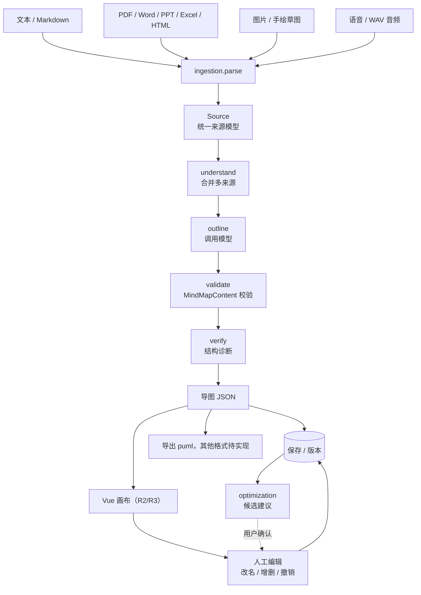

# 端到端流程

本文只看"数据怎么流动"，接口细节见 [API 契约](API.md)，模块职责见 [系统架构](ARCHITECTURE.md)，补齐细节见 [增量附录](ARCHITECTURE_ADDENDUM.md)。

## 1 主链路

## 2 三条入口

| 入口 | 接口 | 输入 | 输出 | 状态 |
|---|---|---|---|---|
| 快速生成（同步） | `POST /api/generations` | 一段文本 | 导图 | 已实现（demo / model） |
| 流式生成（主路径） | `POST /api/generations/stream` | 一段文本 | SSE：节点逐个下发 | 已实现，页面默认走这条 |
| 多来源流水线 | `POST /api/pipeline/generate` | `Source[]` | 导图 + 阶段轨迹 + 诊断 | 已实现（文本来源） |
| 目标驱动 | `POST /api/agent/tasks` | 一句目标 | 阶段骨架 | 桩（不产生导图） |

前两条最终都落到 `MindMapContent`，第三条目前只返回阶段列表。

## 3 每个环节的输入输出

| 环节 | 模块 | 输入 | 输出 | 状态 |
|---|---|---|---|---|
| 来源解析 | `app/ingestion` | 文本 / Markdown 字符串 / 上传的文档、图片或 WAV / 浏览器录音 | `Source` | 文本、文档（Docling + pymupdf）、图片（多模态视觉）、语音（阿里云一句话识别）均已实现 |
| 合并理解 | `app/pipeline._understand` | `Source[]` | 单一文本 | 已实现；任一来源不可用或合并超 20000 字时拒绝，不截断 |
| 大纲生成 | `app/generation` | 文本 | `MindMapContent` | 已实现（demo 占位 / model 调模型） |
| 契约校验 | `app/contracts/mindmap.py` | 任何模型输出 | 合法树 / 异常 | 已实现（300 节点 / 8 层 / 50 子节点） |
| 结构诊断 | `app/optimization.check` | 导图 | `Diagnostic[]` | 单子节点、深度上限、同级重复标签三种结构提示 |
| 候选建议 | `app/optimization.suggest` | 导图 | `Suggestion[]` | 同级重复标签 → dedupe 候选，可信度未评估 |
| 知识检索 | `app/knowledge.search` | 查询串 | `KnowledgeHit[]` | 桩（返回空 + implemented=false） |
| 导出 | `app/export` | 导图 | puml 文本 | puml 已实现，md / opml 待实现 |
| 持久化 | `app/mindmaps` | 导图 + 版本号 | 记录 | 已实现（SQLite + 乐观锁） |

## 4 状态约定

- **已实现**：调用可用，有测试覆盖。
- **桩**：接口固定、返回结构正确，但内容是占位（例如 `implemented: false`、固定阶段列表）。前端应据此禁用入口，不要当成功能完成。
- **未实现**：直接返回 501，不允许返回空对象假装成功。

这条约定写进代码注释，避免半年后有人以为 `knowledge/search` 能用。

## 5 前端接下来要接的位置

| 前端位置 | 调用 | 用途 |
|---|---|---|
| 输入框（`src/App.vue`） | `POST /api/generations/stream` | **已接入**：输入 → 流式生成 → 节点逐个出现 |
| 画布（R2） | 无请求 | **已接入**：`src/canvas/MindMapCanvas.vue` 消费 `content`，坐标由 `src/canvas/layout/tidy.ts` 计算；可平移缩放点选，双击内联改文字，Tab / Enter / Delete 建树，撤销栈最多 50 步 |
| 保存（R3） | `POST /api/mindmaps` / `PUT /api/mindmaps/{id}` | **已接入**：首次保存 POST 建新图，之后 PUT 带 `version`；409 弹三选（重新加载服务端版本 / 另存为新导图 / 取消）；Ctrl+S 触发，`beforeunload` 拦未保存离开 |
| 打开列表（R3） | `GET /api/mindmaps` / `GET /api/mindmaps/{id}` | **已接入**：顶部"打开"弹层列出已保存导图，点开替换画布并清空撤销栈 |
| 上传面板（待接入） | `POST /api/ingestion/files` | 已实现：multipart 上传，Docling 解析后返回 `source`，再传给 `/api/pipeline/generate` |
| 多来源生成（待接入） | `POST /api/pipeline/generate` | 拿 `content` 渲染，`stages` 仅作完成记录展示 |
| 诊断面板（待接入） | `POST /api/optimization/suggest` | 显示建议，用户点确认后再改 |
| 导出按钮（待接入） | `POST /api/export/puml` | 下载文本文件 |

`stages` 随同步响应一次性返回，只能展示完成后的阶段记录，不能显示生成中的实时进度；实时进度需要未来的任务状态接口或 SSE。

## 6 还没搭的部分

- `app/collab/`：协作（F17），Yjs + WebSocket，独立服务，不在本次骨架内。
- `eval/`：评估（F23–F26），跑批脚本与样本集。
- SSE 通道：`GET /api/generation-tasks/{id}/events`，等改成异步任务时再加。
