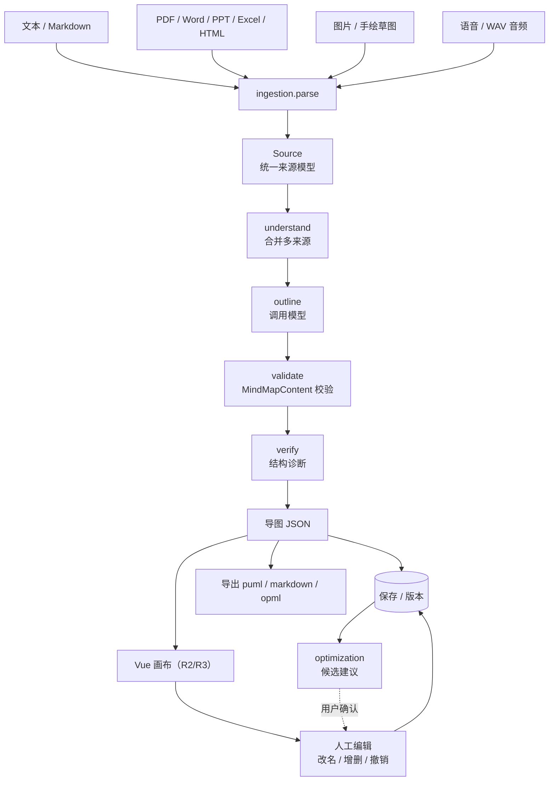

# 端到端流程

本文只看"数据怎么流动"，接口细节见 [API 契约](API.md)，模块职责见 [系统架构](ARCHITECTURE.md)，补齐细节见 [增量附录](ARCHITECTURE_ADDENDUM.md)。

## 1 主链路

## 2 入口

| 入口 | 接口 | 输入 | 输出 | 状态 |
|---|---|---|---|---|
| 生成（唯一入口） | `POST /api/agent/runs/stream` | 目标 + 来源 + 当前树 | SSE v2：阶段 / 工具进度 / 整树候选 / op 批次 / 节点生长预览 | 已实现，页面默认且唯一走这条；产物是候选，需用户接受 |
| 目标驱动 | `POST /api/agent/tasks` | 一句目标 | 阶段骨架 | 桩（不产生导图） |

两条路由都挂在 agent 上，但只有 `/agent/runs/stream` 真的产出内容：它把改动落进候选副本（`snapshot` 整树或 `ops` 批次），用户点了接受才进画布；`/agent/tasks` 只回固定阶段列表。原先的 `POST /api/generations`（同步）、`POST /api/generations/stream`（流式）与 `POST /api/pipeline/generate`（多来源流水线）已删除，前端也不再保留对应的两条通道。

## 3 每个环节的输入输出

| 环节 | 模块 | 输入 | 输出 | 状态 |
|---|---|---|---|---|
| 来源解析 | `app/ingestion` | 文本 / Markdown 字符串 / 上传的文档、图片或 WAV / 浏览器录音 | `Source` | 文本、文档（Docling + pymupdf）、图片（多模态视觉）、语音（百炼 Qwen-Audio-ASR，带句级时间戳）均已实现 |
| 合并理解 | `app/agent/tools.py`（`mindmap_generate` 的忠实整理模式） | `Source[]` | 结构化来源输入（逐项带 `source_id`，供模型写引用） | 已实现；未解析或空内容的来源由前端在提交前挡下（`src/sources/input.ts::sourceInputError`），工具侧只取有正文的来源。长度在开流前按 token 估算卡（`AgentRunRequest.sources_within_context` → `ensure_input_within_context`），超了 422 而不是截断 |
| 大纲生成 | `app/agent/tools.py`（`mindmap_generate` / `mindmap_generate_deep`） | 目标文本（或结构化来源） | `MindMapContent` | 已实现（`MINDMAP_LLM_MODE=demo` 时不调模型，直接发占位树；有来源时只能走 `mindmap_generate` 的忠实整理） |
| 契约校验 | `app/contracts/mindmap.py` | 任何模型输出 | 合法树 / 异常 | 已实现（1000 节点 / 8 层 / 50 子节点） |
| 结构诊断 | `app/optimization.check` | 导图 | `Diagnostic[]` | 单子节点、深度上限、同级重复标签三种结构提示；`mindmap_generate` 收尾时会跑一遍（原先只在流水线收尾跑） |
| 候选建议 | `app/optimization.suggest` | 导图 | `Suggestion[]` | 同级重复标签 → dedupe 候选，可信度未评估 |
| 知识检索 | `app/knowledge.search` | 查询串 | `KnowledgeHit[]` | 桩（返回空 + implemented=false） |
| 导出 | `app/export` | 导图 | puml / markdown / opml 文本 | 三种格式均已实现（2026-11-05） |
| 持久化 | `app/mindmaps` | 导图 + 版本号 | 记录 | 已实现（SQLite + 乐观锁） |

## 4 状态约定

- **已实现**：调用可用，有测试覆盖。
- **桩**：接口固定、返回结构正确，但内容是占位（例如 `implemented: false`、固定阶段列表）。前端应据此禁用入口，不要当成功能完成。
- **未实现**：直接返回 501，不允许返回空对象假装成功。

这条约定写进代码注释，避免半年后有人以为 `knowledge/search` 能用。

## 5 前端接下来要接的位置

| 前端位置 | 调用 | 用途 |
|---|---|---|
| 输入框（`src/App.vue`） | `POST /api/agent/runs/stream` | **已接入**：输入 → 工具循环 → 候选就绪 → 用户点接受才进画布 |
| 画布（R2） | 无请求 | **已接入**：`src/canvas/MindMapCanvas.vue` 消费 `content`，坐标由 `src/canvas/layout/tidy.ts` 计算；可平移缩放点选，双击内联改文字，Tab / Enter / Delete 建树，撤销栈最多 50 步 |
| 保存（R3） | `POST /api/mindmaps` / `PUT /api/mindmaps/{id}` | **已接入**：首次保存 POST 建新图，之后 PUT 带 `version`；409 弹三选（重新加载服务端版本 / 另存为新导图 / 取消）；Ctrl+S 触发，`beforeunload` 拦未保存离开 |
| 打开列表（R3） | `GET /api/mindmaps` / `GET /api/mindmaps/{id}` | **已接入**：顶部"打开"弹层列出已保存导图，点开替换画布并清空撤销栈 |
| 上传面板 | `POST /api/ingestion/files` | **已接入**：`src/components/SourceInputs.vue` 上传文档 / 图片 / WAV，解析后进来源列表，再随生成请求一起发给 agent |
| 多来源生成 | `POST /api/agent/runs/stream` | **已接入**：`src/stores/mindmap.ts` 的 `runGeneration(goal, intent, sources)`，来源原样随请求发出（不拼进 goal），产物是候选 |
| 录音输入 | `POST /api/ingestion/files` | **已接入**：`src/components/RecordButton.vue` + `src/audio/recorder.ts` 采集 16kHz WAV 后走同一条上传链路 |
| 导出按钮 | `POST /api/export/{puml,markdown,opml}` | **已接入**：标题栏下拉菜单，浏览器端落盘 |
| Agent 面板 | `POST /api/agent/runs/stream` | **已接入**：`src/components/AgentPanel.vue` 显示工具进度，候选需点接受才落到画布 |
| 诊断面板（待接入） | `POST /api/optimization/check` / `/suggest` | 接口已实现，界面还没渲染 `diagnostics`；建议需用户确认后再改 |
| 引用展示 | 无请求（读 `node.source_refs`） | **已接入**：`src/mindmap/refs.ts` 负责定位与截断，节点右上角显示引用条数，选中后在详情面板列出来源与位置，点一条在右侧抽屉里看原文并高亮命中句；左侧来源行反向显示"被 N 个节点引用"，点节点名跳转（`buildRefIndex`）；原文只在本次会话可回查 |
| 正文编辑 | 随保存一起发（`note`） | **已接入**：详情面板的 textarea 编辑 `node.note`（≤2000 字，Esc 放弃），失焦或 Ctrl+S 提交；画布与导出都取 `note or label`，朝向（`layout` / `theme.direction`）也随保存与打开往返 |

实时进度只有 agent 那一套：`stage` / `tool_start` / `tool_end` 帧边跑边下发，`snapshot` / `ops` 到的是候选，`done` 才算这一轮有了终态。`/api/agent/tasks` 的阶段列表是固定文案，不能当进度用。

## 6 还没搭的部分

- `app/collab/`：协作（F17），Yjs + WebSocket，独立服务，不在本次骨架内。
- `eval/`：评估（F23–F26），跑批脚本与样本集。
- SSE 通道：`GET /api/generation-tasks/{id}/events`，等改成异步任务时再加。
